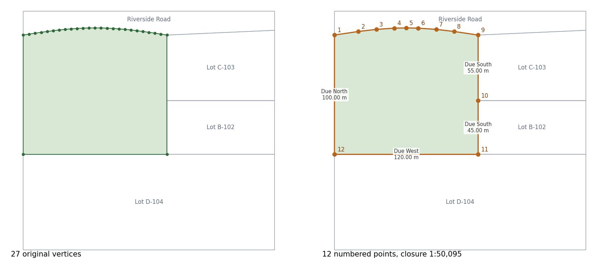

# Parcel Boundary Toolkit

Turns a parcel polygon into the pieces of a boundary description: numbered corner points, straight courses with grid bearings and distances, the adjoining parcel along each course, a coordinate table, a metes-and-bounds text, and the checks a reviewer asks for before signing (closure as written, area difference, largest simplification offset).

It runs as a **Python library**, a **command line tool** and an **ArcGIS Pro toolbox**, all on the same core, so the results are identical in the three.



## Why

Digitised parcels carry far more vertices than a boundary description needs, and the points that do matter are the ones where the neighbour changes. Picking them by hand is slow and hard to check. The toolkit applies three explicit rules:

1. Points are numbered **clockwise** from a point of beginning (the northwest corner by default).
2. A point is **always kept where the adjoining parcel changes**, including where a neighbour's corner falls in the middle of an edge (a T-junction).
3. Between those points, only the bends needed to keep **every digitised vertex within a tolerance** of a straight course are kept (Douglas-Peucker on each stretch with the same neighbour).

Every output says how much the simplification cost: the largest vertex offset, the area enclosed by the numbered points against the parcel area, and the closure of the description **as written**, after bearings are rounded to seconds and distances to centimeters (or hundredths of a foot).

## Quick start

```bash
pip install -e ".[gis]"
python examples/make_example.py            # synthetic block of five parcels (UTM 18N)
python -m boundary_toolkit examples/data/example_parcels.gpkg --layer parcels \
    --id-field parcel_id --ids A-101 --adjoiner-field owner --tolerance 0.25 --out examples/output
```

```text
A-101: 12 points from 28 vertices, closure 1:50,095
```

Part of the description it writes (`examples/output/A-101_description.md`):

```text
Beginning at Point 1, the point of beginning, with grid coordinates X = 500,000.000 and Y = 1,200,100.000;
thence N 81°28'09" E, a distance of 20.22 meters, along Riverside Road, to Point 2;
...
thence Due South, a distance of 55.00 meters, along Lot C-103, to Point 10;
thence Due South, a distance of 45.00 meters, along Lot B-102, to Point 11;
thence Due West, a distance of 120.00 meters, along Lot D-104, to Point 12;
thence Due North, a distance of 100.00 meters, to the point of beginning.

Containing 1.2458 hectares (12,458 square meters), more or less.
```

| Check | Value |
|---|---|
| Largest offset of a digitised vertex from its course | 0.093 m |
| Area difference, numbered points vs. parcel | −5.02 m² (−0.04 %) |
| Closure of the description as written | 0.0088 m (1:50,095) |

### ArcGIS Pro

Add `arcgis/ParcelBoundaryToolkit.pyt` to a project (Catalog > Toolboxes > Add Toolbox) and run **Describe Parcel Boundaries**. It needs no extra packages: it reads the parcels with ArcPy, calls the same core, and writes `boundary_points` and `boundary_courses` to `boundaries.gdb` plus the same tables and descriptions as the command line.

### Python

```python
from boundary_toolkit import describe_ring, legal_description, Units

b = describe_ring(coords, edge_labels, tolerance=0.1)       # coords in a projected CRS
print(legal_description(b, Units("feet", "foot"), "Lot 7", "NAD83 / California zone 3 (ftUS)"))
```

## Real data check: Weld County, Colorado

`examples/real_parcels_weld_county.py` downloads 100 parcels from a few residential blocks in Greeley from the [Weld County open data service](https://services.arcgis.com/ewjSqmSyHJnkfBLL/arcgis/rest/services/Parcels_open_data/FeatureServer) (geometry, parcel number, subdivision, block, lot and the county's acreage; no owner names or addresses), projects them to NAD83 / Colorado North (ftUS), EPSG:2231, and describes the 65 parcels that are not cut by the edge of the download, naming each neighbour by its parcel number. The data are fetched again on every run and are not stored in the repository.

| Result over 65 parcels | Value |
|---|---|
| Digitised vertices per parcel | 4 to 9 |
| Numbered points per parcel | 4 to 8 |
| Largest offset of a vertex from its course (0.1 ft tolerance) | 0.004 ft |
| Misclosure of the description as written | at most 0.0149 ft; worst ratio 1:36,154 |
| Toolkit area against the county's `GIS_Acres` | −0.008 % to −0.007 % |

The area difference is the same sign and size for every parcel, which points to a difference in how the county computed its acreage rather than to the parcels themselves. A sample description:

```text
Beginning at Point 1, the point of beginning, with grid coordinates X = 3,223,326.070 and Y = 1,394,225.200;
thence Due East, a distance of 99.68 feet, along Parcel 096107401005, to Point 2;
thence S 00°04'08" W, a distance of 80.00 feet, along Parcel 096107401007, to Point 3;
thence Due West, a distance of 99.58 feet, to Point 4;
thence Due North, a distance of 80.00 feet, to the point of beginning.

Containing 0.183 acres (7,970 square feet), more or less.
```

## Outputs

| File | Content |
|---|---|
| `<id>_points.csv` | point number, X, Y |
| `<id>_courses.csv` | course, from, to, quadrant bearing, azimuth, distance, adjoiner, largest offset |
| `<id>_description.md` | metes-and-bounds text and quality checks |
| `boundaries.gpkg` / `boundaries.gdb` | point and course layers for the map |

Units follow the CRS: meters give hectares, US survey feet give acres. `--area-style ha-m2` writes areas as `X ha + YYYY m²`, the notation used in Colombian land administration.

## Tests

```bash
pip install -e ".[test]" && pytest
```

The suite covers bearing formatting (including the 59.9996" carry), clockwise ordering and label permutation, collinear and real bends, changes of adjoiner, T-junctions with neighbours, written-closure arithmetic, area notation and CRS validation. Each core rule was checked by breaking it on purpose and confirming that the matching test fails.

## Limits

* Bearings are **grid bearings** in the projected CRS of the data, not true or magnetic bearings, and distances are grid distances; no scale factor or elevation reduction is applied.
* Single-part parcels only; interior rings are reported but not described.
* The output is a draft for a licensed surveyor or a land-administration professional to review, not a legal description by itself.

## Author

Lina María Quintero Fonseca, geographer, MSc student in Geomatics at the Universidad Nacional de Colombia. The rules come from boundary work in land administration; the code and the example data are written from scratch and contain no institutional data.

MIT License. To cite, use `CITATION.cff`.
